<div align="center">

# Asclepius

**A healthcare-IT platform where clinical AI has to show its work.**

FHIR R4 · SMART on FHIR (PKCE) · HL7 v2.5.1 · ABDM-aligned consent · explainable, verified, governed clinical AI


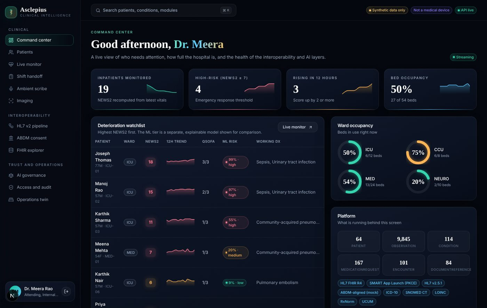

</div>

> **Not a medical device.** Every patient, note, image and identifier in this repository is synthetic. Nothing here has been clinically validated. It is an engineering portfolio project that demonstrates how health software should be built: standards-first, secure by default, and honest about what its AI can and cannot do.

## Why this exists

Most "medical AI" demos are a chat box over a model. Real hospital software is mostly the opposite: standards, plumbing, access control, auditability, and guardrails around any model that touches a clinician's decision. Asclepius builds those parts properly and puts a small amount of AI on top of them, where every output is **cited, verified, explained, audited and measured**.

## What is inside (14 modules)

| # | Module | What it demonstrates |
|---|---|---|
| 1 | **FHIR R4 server** | Search with `_count`, `$everything`, CapabilityStatement, OperationOutcome errors, patient-scoped access |
| 2 | **SMART App Launch** | Authorization code + PKCE S256, launch context, scope and patient enforcement (real flow runs in the browser) |
| 3 | **HL7 v2 pipeline** | ADT/ORU ingestion, ACK/NAK, idempotency, out-of-order retry with backoff, dead-letter queue and replay |
| 4 | **ABDM-aligned consent** | ABHA validation (demo Verhoeff scheme), consent request/grant/revoke, server-enforced data release |
| 5 | **Clinical note coder** | Negation, hedging, history and family-history aware ICD-10 / SNOMED CT coding with confidence and a human review queue |
| 6 | **Differential copilot** | Ranked differential from damped likelihood ratios, every claim cited to chart evidence `[E#]`, ignores the clinician's impression to avoid anchoring |
| 7 | **Safety verifier** | Six independent checks gate every narrative: citation coverage and validity, numeric fidelity, chart consistency, allergy safety, scope guard |
| 8 | **Early warning** | NEWS2 (RCP) and qSOFA computed exactly, plus a learned 24 h risk model with exact additive explanations and calibration |
| 9 | **Live monitor** | Server-sent-event telemetry stream, NEWS2 recalculation, band-crossing alarms |
| 10 | **Medication safety** | Brand to RxNorm normalisation, interactions, allergy cross-reactivity, CKD-EPI renal dosing, multi-source reconciliation |
| 11 | **Ambient scribe** | Transcript to SOAP note with quotes as evidence and a draft FHIR bundle; nothing is written until a physician signs |
| 12 | **Access and audit** | Role + care-team + consent checks, break-glass with privacy-officer review, SHA-256 hash-chained tamper-evident audit log |
| 13 | **AI governance** | Model cards, PSI drift, subgroup fairness (four-fifths rule), calibration, clinician override tracking |
| 14 | **Ops twin and imaging** | Holt-Winters bed forecast, Erlang C + discrete-event OPD simulation, LOS regression, patient-flow Sankey; synthetic MRI/X-ray viewer with AI overlay |

### Newer additions

- **Terminology service**: FHIR `$lookup`, `$validate-code`, `$expand` and `$translate` plus `/api/terminology/*`, with a searchable page.
- **Synthea import**: load a Synthea FHIR bundle (a sample is bundled) from the Terminology page or `import-synthea` CLI; every import is audited.
- **3D body map**: organ-system view of a patient's problems and abnormal results; click an organ to filter the whole chart to it. A ranked list is the keyboard-accessible equivalent.
- **Discharge summary**: a draft assembled from the chart, print-ready, and clearly marked as requiring physician signature.
- **Bedside calculators**: CHA2DS2-VASc, CURB-65, Cockcroft-Gault, BMI/BSA and corrected calcium, with every component shown (`/api/calculators`, page at `/calculators`, `g` then `c`).
- **CDS Hooks**: a `patient-view` service (`/cds-services`) that returns advisory cards for NEWS2 deterioration and critical results; access-checked and audited.
- **FHIR bulk export**: `GET /fhir/$export` produces NDJSON per resource type, limited to patients the caller may see, with one audit entry per patient.
- **Themes**: Clinic day, ICU night and a high-contrast mode (`t` cycles themes, `h` toggles contrast).
- **Customisable dashboard**: drag, resize and hide widgets; layout is saved in the browser.
- **Onboarding and navigation**: spotlight tour, alerts drawer, and keyboard shortcuts (`?` lists them, `g` then a letter jumps to a page).

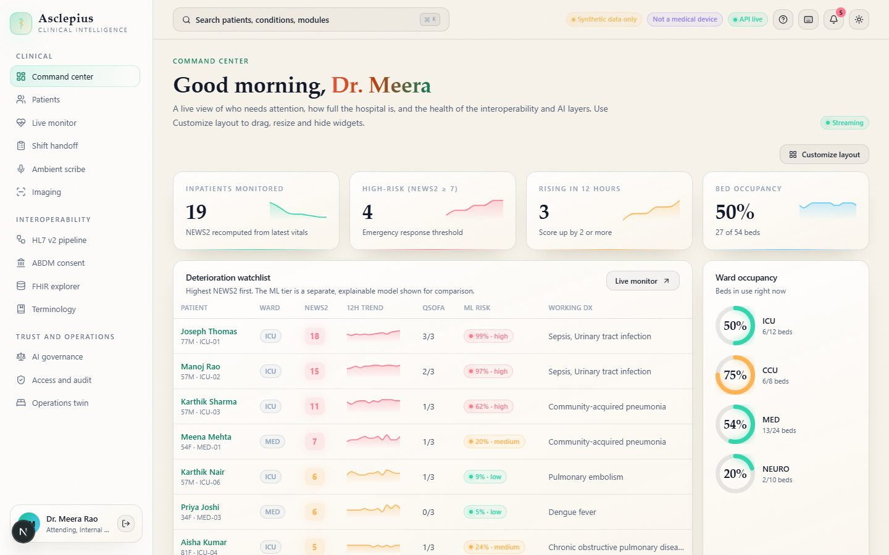
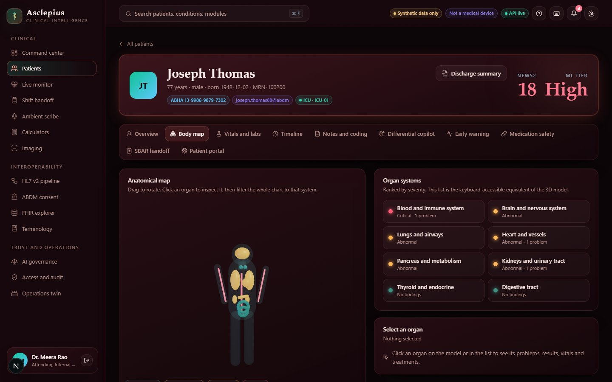
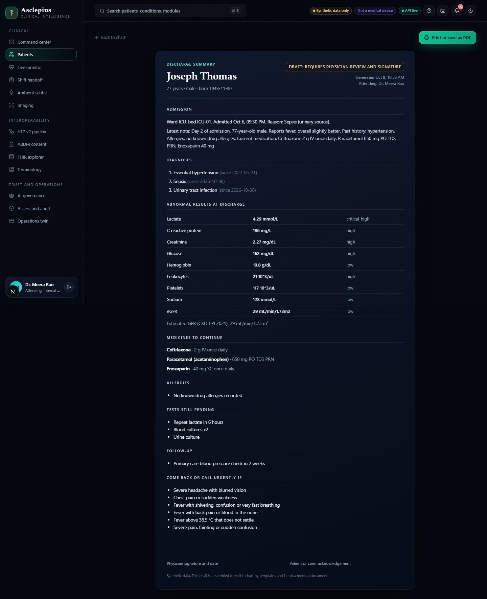
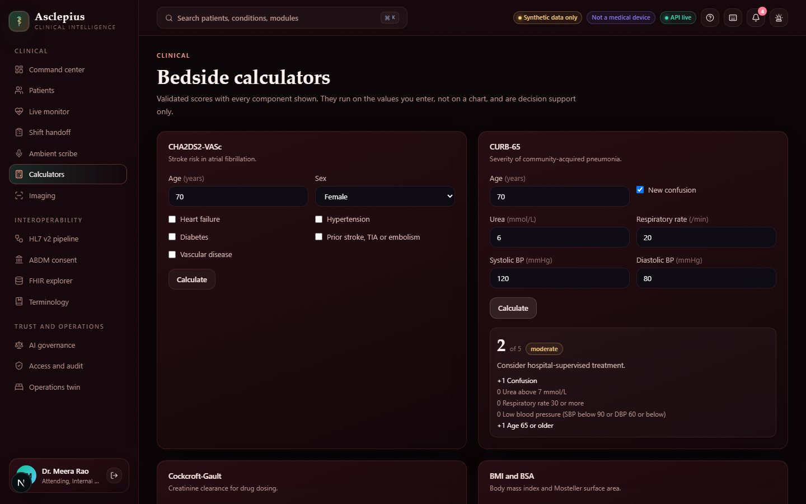

Also: multilingual (English, Tamil, Hindi) patient-friendly summaries with a clinician approval gate, SBAR shift handoff, and a command palette (`Ctrl/Cmd + K`).

<table>
<tr>
<td>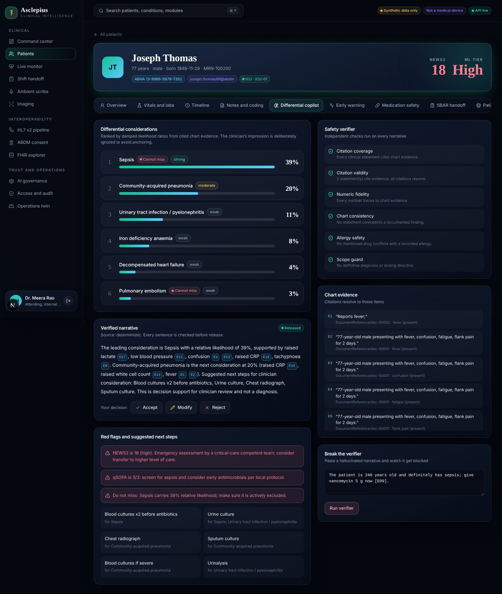</td>
<td>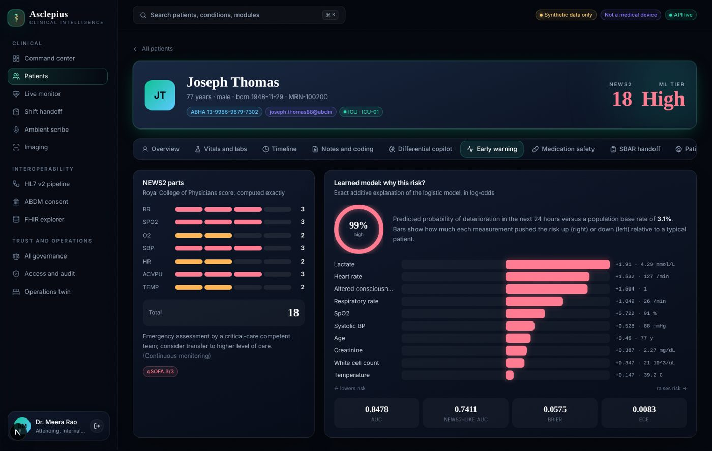</td>
</tr>
<tr>
<td>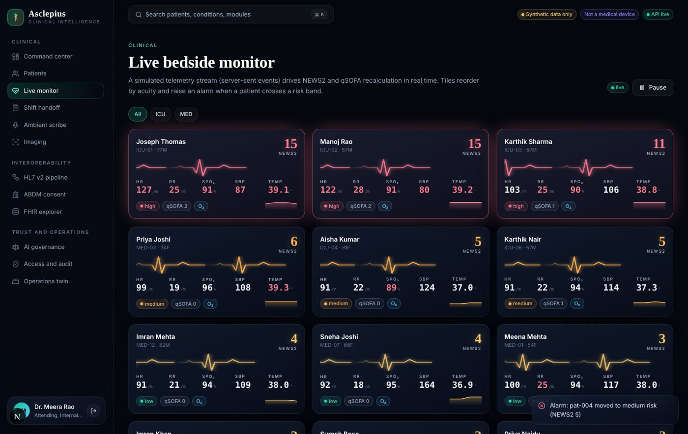</td>
<td>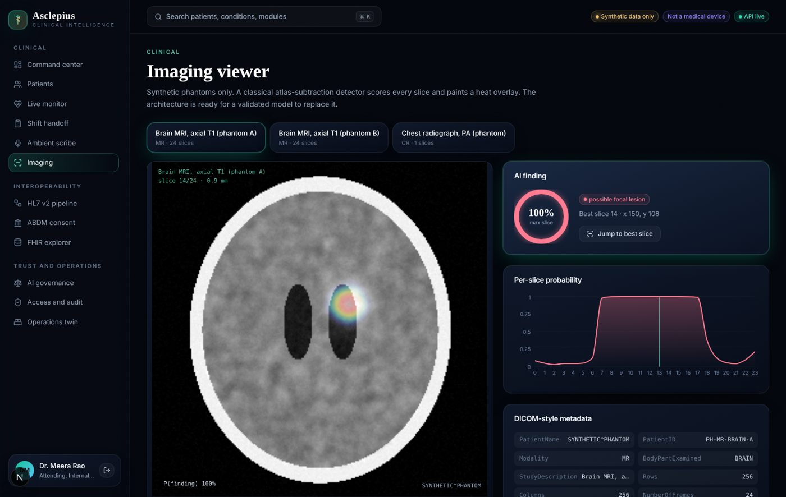</td>
</tr>
<tr>
<td>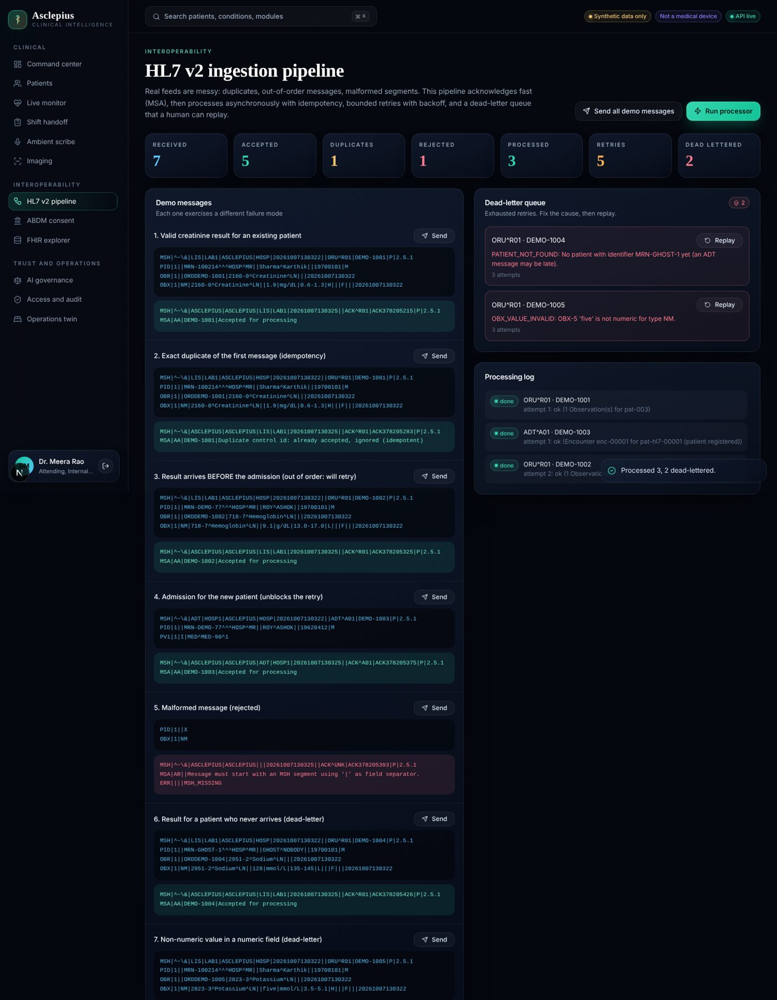</td>
<td>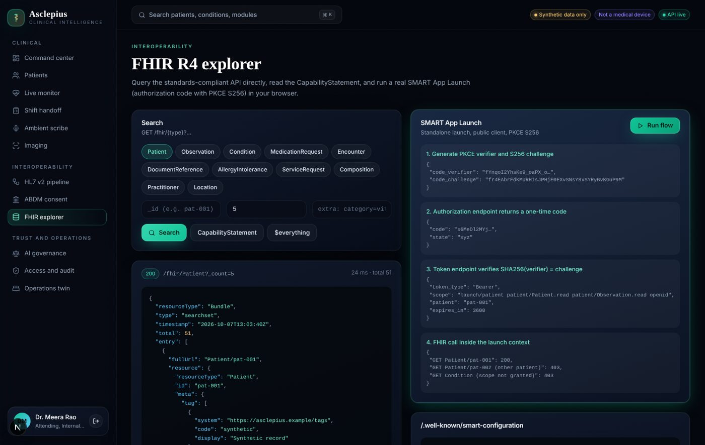</td>
</tr>
<tr>
<td>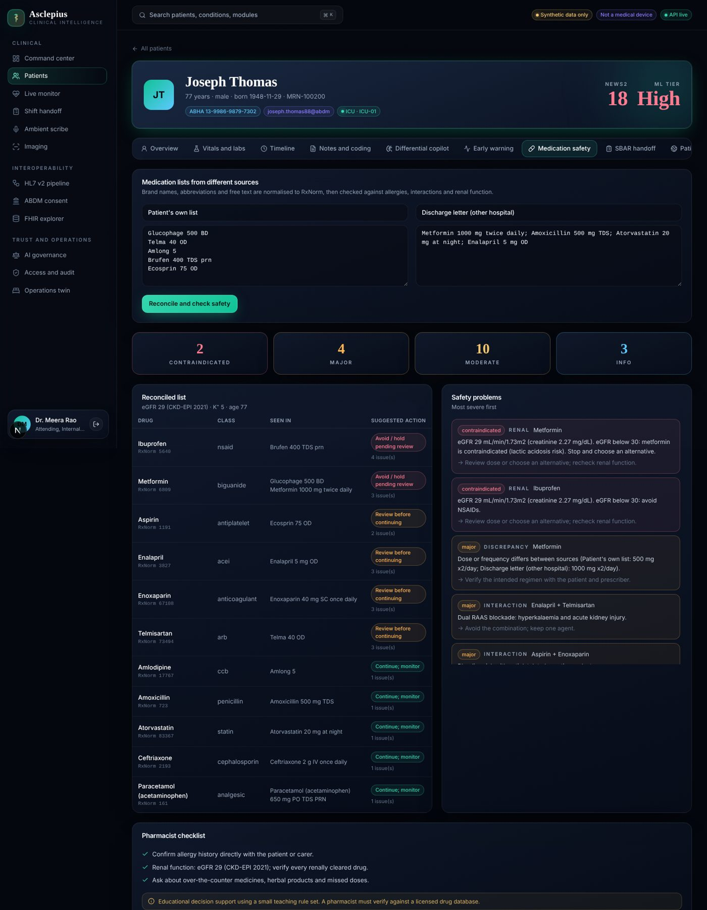</td>
<td>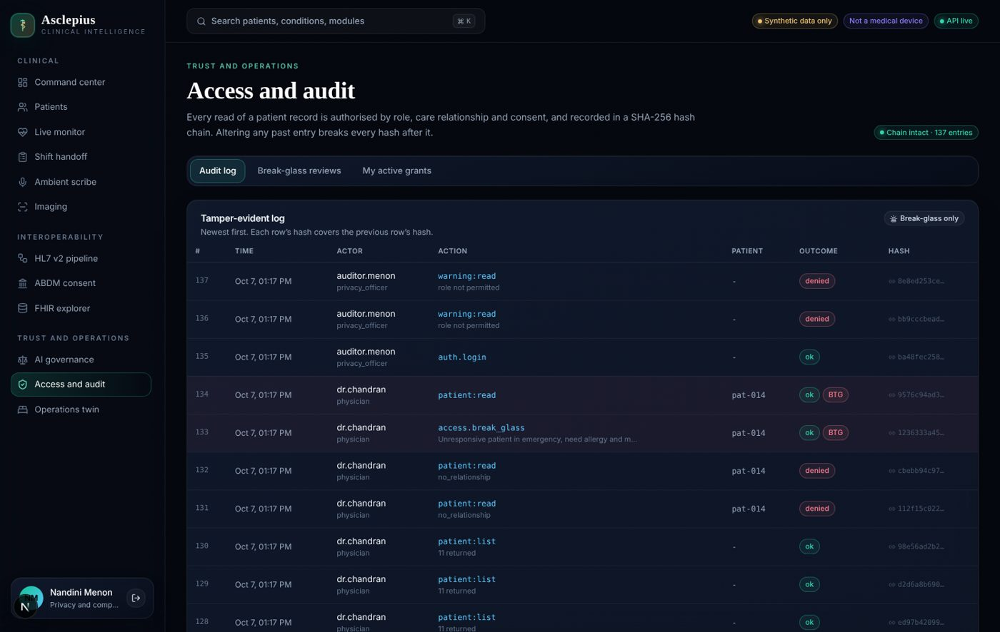</td>
</tr>
</table>

## Quick start

```bash
# 1. API (Python 3.12+)
cd backend
pip install -e ".[dev]"
uvicorn asclepius.main:create_app --factory --port 8000     # docs at http://localhost:8000/api/docs

# 2. Web (Node 20+)
cd frontend
npm install
npm run dev                                                  # http://localhost:3000
```

Or `docker compose up --build`. Pick a persona on the sign-in screen. Try this tour:

1. **Dr. Meera Rao** → Patients → *Joseph Thomas* → **Differential copilot**. Click a `[E#]` citation, then use *Break the verifier* with a hallucinated narrative and watch it get blocked.
2. **Dr. Arvind Chandran** → open a locked patient → **Break glass** → then sign in as **Nandini Menon** (privacy officer) and review it in *Access and audit*.
3. **HL7 pipeline** → *Send all demo messages* → *Run processor* → replay a dead-letter item.
4. **FHIR explorer** → *Run flow* to watch a real SMART PKCE launch, including the 403s that prove scope enforcement.
5. **Ambient scribe** → *Draft note* → tick approvals → *Sign and write to chart*.

## Architecture

```
┌───────────────┐   /api, /fhir (rewrites)   ┌────────────────────────────────────────────┐
│  Next.js 15   │ ─────────────────────────► │ FastAPI                                    │
│  React 19     │ ◄───────── SSE ─────────── │  api.py  ── RBAC/ABAC + consent + audit    │
│  Tailwind     │                            │  fhir.py / terminology.py / clinical.py    │
│  Framer       │                            │  hl7.py  abdm.py  security.py              │
│  Recharts/R3F │                            │  copilot · coding · warning · medrec ·     │
└───────────────┘                            │  scribe · sbar · portal · ops · imaging ·  │
                                             │  governance                                │
                                             │  SQLite (FHIR JSON store + audit chain)    │
                                             └────────────────────────────────────────────┘
```

Design decisions are explained in [docs/ARCHITECTURE.md](docs/ARCHITECTURE.md); the AI safety case is in [docs/SAFETY.md](docs/SAFETY.md); the API surface is in [docs/API.md](docs/API.md).

## Engineering principles

- **Standards first.** Resources are real FHIR R4 JSON with LOINC, SNOMED CT, ICD-10, RxNorm and UCUM codings.
- **Fail closed.** Unknown user, missing scope, no care relationship, or no consent means denial, and the denial is audited.
- **AI is a suggestion, never an actor.** Deterministic, inspectable models; every sentence verified; override rates measured.
- **Honest evaluation.** Metrics are reported on synthetic data and labelled optimistic. Fairness flags are shown even when they are noise.
- **Reproducible.** Fixed seeds, in-memory database by default, 92% backend test coverage, 22 browser end-to-end tests, CI with secret scanning.

## Tests

```bash
cd backend && python -m pytest --cov=asclepius -q   # 74 tests, 92% coverage
cd frontend && npm run e2e:install && npm run e2e   # 22 Playwright tests (or `make e2e`)
```

The e2e config starts the backend and frontend itself; set `E2E_REUSE=1` to reuse servers already running.

Covers NEWS2 bands, qSOFA, coder negation scope, verifier blocking, HL7 idempotency/retry/DLQ, SMART PKCE (including a wrong verifier), break-glass, audit-chain tamper detection, FHIR errors, ABDM consent enforcement, ops models and imaging, plus the terminology service, Synthea import, body map and discharge draft. Browser tests cover sign-in and roles, themes, the tour, widgets, the body map, break-glass and the HL7 pipeline.

## Limitations (read these)

- Synthetic data only; models are teaching-grade and validated on data generated from similar assumptions, so results are optimistic.
- ABDM and SMART are **mocks** that follow the shape of the real flows; there is no connection to any gateway.
- Demo sign-in has no passwords. A real deployment needs an identity provider, MFA, TLS, write-once audit storage and a clinical-safety case.
- The imaging detector is a classical algorithm on phantoms, shown to demonstrate the integration pattern, not diagnostic ability.

## Repository history

This project replaces an earlier prototype that lived in this repository. The rebuild shares no code or branding with it.

## License

MIT. See [LICENSE](LICENSE).
